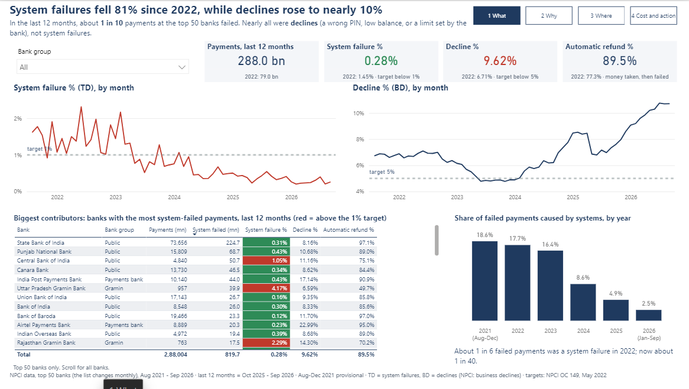
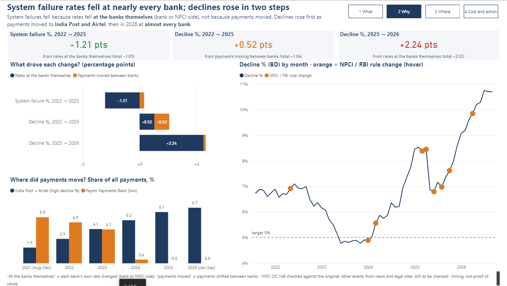
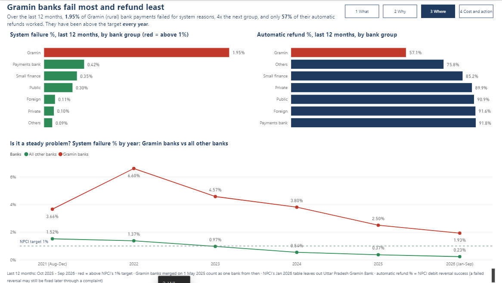
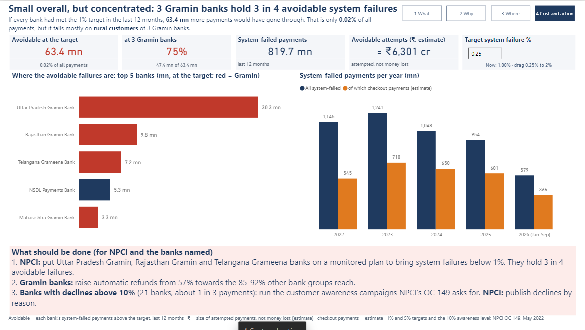

# Where Does UPI Fail? A Bank-wise Payment Failure Analysis

My own UPI payments kept failing, so I used NPCI's monthly data on the top 50 banks (Aug 2021 to Sep 2026, 3,100 bank-months) to find out **what** fails, **why** it changed, **where** it still fails, and **what it costs**.

## Key findings

1. **System failures fell 81% since 2022, while declines rose to nearly 10%.** System failures (TD: bank or NPCI side) fell from 1.45% in 2022 to 0.28% in the last 12 months (Oct 2025 - Sep 2026), below NPCI's 1% target every month since Mar 2024. Declines (BD: a wrong PIN, low balance, or a limit set by the bank) went from 6.71% to 9.62%, nearly double NPCI's 5% target. In the last 12 months about 1 in 10 payments failed, and nearly all of those were declines.
2. **System failure rates fell at the banks themselves; payments didn't just move to better banks.** Splitting the change bank by bank: −1.21 points of the −1.05 drop in system failures came from rates at the banks themselves (bank or NPCI side). Half of the 2022→2025 rise in declines (+0.52 of +1.04) came from payments moving to payments banks with high declines (India Post, Airtel) as Paytm Payments Bank left. The 2025→2026 rise (+2.32) is almost all banks themselves (+2.24).
3. **Declines dropped suddenly in May 2025 at 45 of the 47 banks present in both months**, then rose every month to 10.7%. Other years move by at most 0.35 points from April to May, so a drop at almost every bank at once points to a system-wide change (rules or how declines are counted). The closest dated event is NPCI's 26 Apr 2025 circular on status checks. *Timing, not proof of cause.*
4. **Gramin (regional rural) banks fail most and refund least.** Over the last 12 months their system failure rate is 1.95%, more than 4x the next group (payments banks, 0.42%). When money is taken and the payment fails, only 57% of their automatic refunds work, against 85–92% at other bank groups. They have been above the 1% target every year. Uttar Pradesh Gramin Bank was above 1% in all 11 of its months.
5. **So what: small overall, but concentrated in 3 Gramin banks.** If every bank had met NPCI's 1% target over the last 12 months, 63.4 mn more payments would have gone through (about ₹6,300 crore of attempted payments, an estimate, not money lost). That is only 0.02% of all payments, but 52.8 mn of it is at Gramin banks, which carry about 1.8% of the top 50 banks' payments, and 47.4 mn (3 in 4) at just 3 banks: Uttar Pradesh Gramin, Rajasthan Gramin and Telangana Grameena.
6. **Festival months (Oct–Nov) had fewer system failures in every year, but it is not statistically proven** (Mann-Whitney p = 0.067, each month compared with its own year's average).

**Recommendations (for NPCI and the banks named):**
1. **NPCI:** put Uttar Pradesh Gramin, Rajasthan Gramin and Telangana Grameena banks on a monitored plan to bring system failures below 1%. They hold about 3 in 4 avoidable system failures.
2. **Gramin banks:** raise automatic refunds from 57% towards the 85–92% other bank groups reach.
3. **Banks with declines above 10%** (21 banks, about 1 in 3 payments in the last 12 months): run the customer awareness campaigns NPCI's OC 149 (13 May 2022) asks for. **NPCI:** publish declines by reason.

## Power BI dashboard

Open `powerbi/UPI Failure Dashboard.pbip` in Power BI Desktop and click Refresh. Four pages tell the story in order: **1 What** happened, **2 Why** it changed, **3 Where** it still fails, **4 Cost and action**. Red = above NPCI's 1% target, green = within, orange = events, payments moved, or estimates.






## Charts


## The funnel and the words used

```
Payment started (Total Volume)
 ├─ Approved                         Approved %
 ├─ Declined (BD)                    a wrong PIN, low balance, or a limit set by the bank  → "Decline %"
 └─ System failure (TD)              bank-side or NPCI-side system/network error          → "System failure %"
```

- **System failure % (TD):** covers bank-side and NPCI-side errors, so this project says "system failure", not "the bank's fault".
- **Decline % (BD, NPCI: "business decline"):** not all declines are bad (a wrong PIN should be declined), and NPCI's OC 149 marks some decline codes as bank induced (limits set by the bank), so this project says "declines", not "user failures".
- **Automatic refund %:** NPCI's debit reversal success: when money is taken but the payment fails, how often it comes back automatically. A failed reversal may still be fixed later through a complaint.
- **Targets:** TD below 1% and BD below 5%, from NPCI OC 149 (13 May 2022, as advised by RBI); OC 149A (15 Jun 2022) is only the addendum. OC 149 also asks banks with BD above 10% to run customer awareness campaigns.
- **Changes in a rate** are in percentage points (pts), not %.

## Questions and where each is answered

| # | Question | SQL / Python |
|---|---|---|
| 1 | What: how have failures shifted from system failures (TD) to declines (BD), overall and by bank group? | `sql/03_q1_system_vs_user_failures.sql` |
| 2 | Why: did rates change at the banks themselves, or did payments move between banks? | `sql/04_q2_banks_changed_or_payments_moved.sql` |
| 3 | Why: do changes line up with dated NPCI / RBI events? | `sql/05_q3_events_timeline.sql` |
| 4 | Where: which banks and groups still fail most, steady or spikes? | `sql/06_q4_worst_banks.sql` |
| 5 | Impact: when money is taken and the payment fails, does the automatic refund work? | `sql/07_q5_refunds.sql` |
| 6 | So what: what did system failures cost (payments, Rs, checkout payments)? | `sql/08_q6_cost_of_failures.sql`, `excel/upi_cost_model.xlsx` |
| 7 | Extra: are festival months different? | `sql/09_q7_festival_months.sql`, `python/step3_festival_test.py` |

<details>
<summary>More numbers</summary>

**Failure rates per year (volume-weighted)**

| Year | System failure % | Decline % | Automatic refund % |
|---|---|---|---|
| 2021 (Aug–Dec) | 1.55 | 6.76 | 75.88 |
| 2022 | 1.45 | 6.71 | 77.27 |
| 2023 | 1.01 | 5.15 | 79.75 |
| 2024 | 0.59 | 6.23 | 68.36 |
| 2025 | 0.40 | 7.76 | 83.99 |
| 2026 (Jan–Sep) | 0.26 | 10.08 | 89.68 |

**Cost of system failures (estimates)**

| Year | System-failed payments (mn) | Value of failed attempts (Rs crore)* | Checkout (P2M) payments hit (mn)** |
|---|---|---|---|
| 2022 | 1,145 | 176,455 | 545 |
| 2023 | 1,241 | 166,248 | 710 |
| 2024 | 1,048 | 127,950 | 650 |
| 2025 | 954 | 108,265 | 601 |
| 2026 (Jan–Sep) | 579 | 68,238 | 366 |

\* Only for the 92–100% of failed payments where NPCI's two tables agree on the bank's volume. This is the size of failed attempts, not money lost: most people retry.
\*\* Estimate: failed payments x that month's share of shop payments.

**Why the 2025–2026 rise in declines? Dated events (sources in `sql/05`; timing, not proof of cause)**

| Month | Event |
|---|---|
| May 2022 | NPCI OC 149: TD below 1%, BD below 5%; banks above 10% BD to run awareness campaigns |
| Apr 2025 | Big UPI outage; NPCI circular on status checks (26 Apr) |
| Jun 2025 | NPCI cuts response time to 10–15 seconds |
| Aug 2025 | NPCI API limits: 50 balance checks a day per app, AutoPay only off-peak |
| Oct 2025 | P2P collect requests end |
| Apr 2026 | RBI two-factor rules for digital payments |

Possible reasons, **not proven by this data**: AutoPay payments that fail for low balance count as declines, and AutoPay keeps growing; stricter checks add friction. The 2026 rise is an open question.

</details>

## Data

| Source | What |
|---|---|
| [NPCI UPI Ecosystem Statistics](https://www.npci.org.in/what-we-do/upi/upi-ecosystem-statistics) (Jan 2022 → Sep 2026, from NPCI's statistics feed) | Monthly top 50 remitter banks: volume, Approved / BD / TD %, debit reversals; bank volume and value; P2P / P2M; apps |
| [NPCI archive](https://npci.org.in/what-we-do/upi/upi-ecosystem-statistics/archives) (Aug–Dec 2021) | Same bank table, read from the archive page (marked provisional) |

- No months are missing from Aug 2021 to Sep 2026. Every number comes from these files; nothing is filled in.
- **One bank missing in one month:** NPCI's Jan 2026 table leaves out Uttar Pradesh Gramin Bank, although NPCI's other table shows it was big enough for the top 50 (69.6 mn approved payments). It stays missing, so Gramin figures for the last 12 months are slightly too low.
- **Gramin bank merger (1 May 2025):** NPCI switches between old and new names after the merger, so from May 2025 each merged bank is counted once under its new name (details in `data/raw/SOURCES.md`).
- NPCI published Aug 2022's refund success % without the decimal point (e.g. 9123.00%); it is divided by 100 in cleaning and marked red in `excel/upi_clean_data.xlsx`.
- Every bank spelling is mapped to one name and type in `data/bank_names.csv`; every change is shown in the Excel "Before vs after" sheet.
- Industry rates are volume-weighted (total failed / total payments), never an average of percentages.
- **Avoidable failures are a lower bound:** only the top 50 banks are in the data, the list changes monthly, and some banks are not in every month.
- **Declines are not all bad:** a wrong PIN or low balance should be declined, so the target is fewer avoidable declines, not zero.
- **The bank table counts attempts:** total volume includes failed payments, so it can be larger than NPCI's headline count of successful payments; shares can come out above 100% if compared with that headline count.
- Limits: top 50 banks only; TD mixes bank and NPCI errors; the 2021 rows are provisional. See [`docs/week0_data_check.md`](docs/week0_data_check.md) and [`docs/decisions.md`](docs/decisions.md).

## Repo layout

```
data/raw/            NPCI files exactly as downloaded, plus one raw CSV per table
data/bank_names.csv  every bank spelling NPCI used -> one standard name and bank type
data/app_names.csv   every app spelling NPCI used -> one standard app name
data/clean/          clean tables (CSV)
python/              step1 download, step2 clean, step3 festival test, step4 cost model, step5 charts
sql/                 01 load, 02 extra columns, 03-09 one file per question, 10 cost model inputs, 11 Power BI export
excel/               upi_clean_data.xlsx (before vs after), upi_cost_model.xlsx (what-if)
powerbi/             UPI Failure Dashboard.pbip (open in Power BI Desktop), theme, build guide, data
images/              charts for this README
docs/                decisions log, data dictionary, coding style, data check
```

## Tools

Python (pandas, SciPy, Matplotlib) · PostgreSQL (joins, GROUP BY, CASE, views) · Excel (what-if model with live formulas) · Power BI (DAX)

## Run it

```powershell
python -m venv .venv; .venv\Scripts\activate
pip install -r requirements.txt
python python/step1_get_raw_data.py     # download NPCI data (skips files already saved)
python python/step2_clean_data.py       # build data/clean/, stops if any check fails
$psql = "C:\Program Files\PostgreSQL\18\bin\psql.exe"
& $psql -U postgres -d upi_failure -f sql/01_load_tables.sql     # load the clean CSVs
& $psql -U postgres -d upi_failure -f sql/02_extra_columns.sql   # calculated columns
# questions: open sql/03 ... sql/09 in pgAdmin, or run them with psql the same way
& $psql -U postgres -d upi_failure -f sql/05_q3_events_timeline.sql   # makes the events table
& $psql -U postgres -d upi_failure -f sql/10_cost_model_inputs.sql
& $psql -U postgres -d upi_failure -f sql/11_powerbi_export.sql
python python/step3_festival_test.py    # Q7 test + chart
python python/step4_build_cost_model.py # Excel what-if model
python python/step5_charts.py           # README charts
```

## Sources

National Payments Corporation of India (NPCI), UPI Ecosystem Statistics. Event sources (NPCI circulars and RBI directions, as reported by Business Standard, Upstox, Tribune India, SCC Online, Outlook Money, Khaitan & Co) are listed in `sql/05_q3_events_timeline.sql`.
