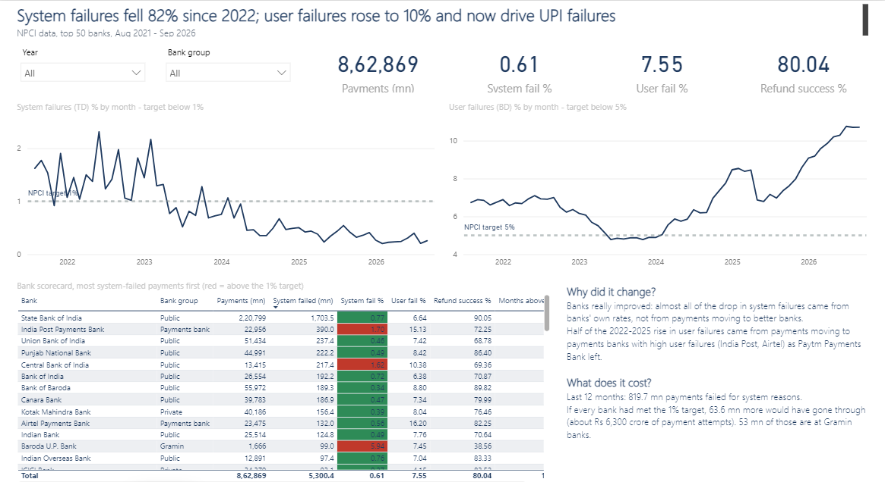
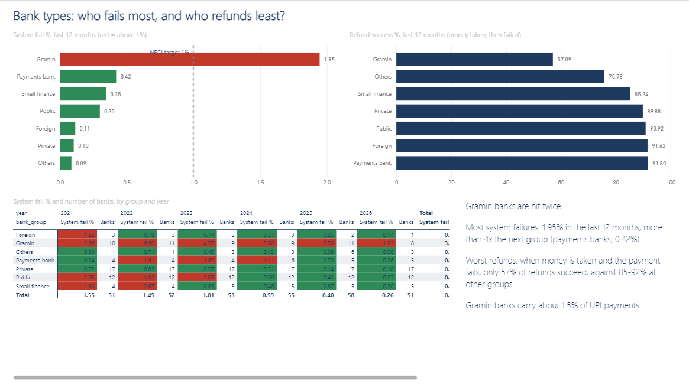
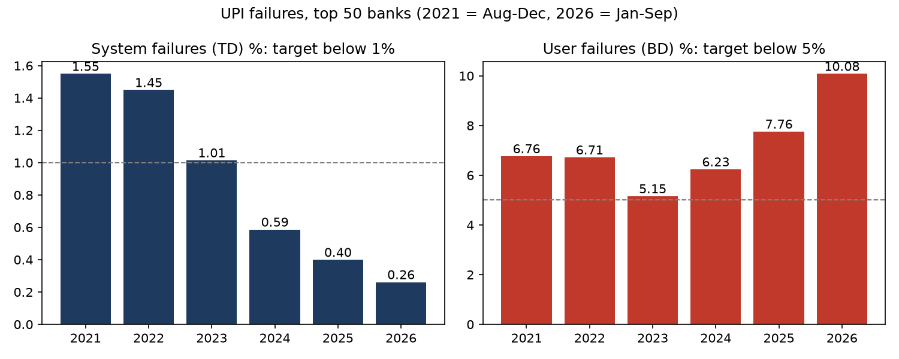
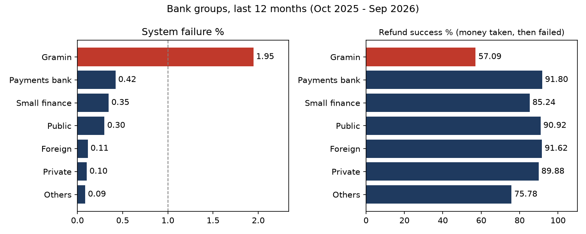

# Where Does UPI Fail? A Bank-wise Payment Failure Analysis

My own UPI payments kept failing, so I used NPCI's monthly data on the top 50 banks (Aug 2021 to Sep 2026, 3,100 bank-months) to find out **what** fails, **why** it changed, **where** it still fails, and **what it costs**.

## Key findings

1. **System failures fell more than 5x; user failures rose and now drive the problem.** System failures (TD: bank or NPCI systems) fell from 1.45% in 2022 to 0.26% in 2026, below NPCI's 1% target since 2024. User failures (BD: wrong PIN, low balance, limits) went from 6.71% to 10.08%, double NPCI's 5% target.
2. **The banks really improved: payments didn't just move to better banks.** Splitting the change bank by bank: −1.22 points of the −1.05 drop in system failures came from banks' own rates. Half of the 2022→2025 rise in user failures (+0.51 of +1.04) came from payments moving to high-failure payments banks (India Post, Airtel) as Paytm Payments Bank left.
3. **User failures dropped suddenly in May 2025 at 48 of 50 banks**, then rose every month to 10.7%. Other years move by at most 0.35 points from April to May, so a drop at almost every bank at once points to a system-wide change (rules or how declines are counted). The closest dated event is NPCI's 26 Apr 2025 circular on status checks. *Not proven by this data.*
4. **Gramin (regional rural) banks are hit twice.** Over the last 12 months their system failure rate is 1.95%, more than 4x the next group (payments banks, 0.42%). When money is taken and the payment fails, only 57% of their refunds succeed, against 85–92% at other bank groups. Baroda U.P. Bank was above the 1% target in all 8 of its months.
5. **So what: about 10 small banks hold most of the fix.** If every bank had been at NPCI's 1% target over the last 12 months, 63.6 mn failed payments (about Rs 6,300 crore of attempts) would have gone through. 53 mn of those are at Gramin banks, which carry only about 1.5% of UPI payments.
6. **Festival months (Oct–Nov) had fewer system failures in every year, but it is not statistically proven** (Mann-Whitney p = 0.067, each month compared with its own year's average).

## Power BI dashboard

Open `powerbi/UPI Failure Dashboard.pbip` in Power BI Desktop and click Refresh. Red = above NPCI's 1% target, green = within.




## Charts




## The funnel

```
Payment started (Total Volume)
 ├─ Approved                         Approved %
 ├─ Failed: business decline (BD)    wrong PIN, low balance, limit crossed  → user failure
 └─ Failed: technical decline (TD)   bank or NPCI system/network error      → system failure
```

TD covers both bank-side and NPCI-side errors, so this project says "system failure", not "the bank's fault".

## Questions and where each is answered

| # | Question | SQL / Python |
|---|---|---|
| 1 | What: how have failures shifted from systems (TD) to users (BD), overall and by bank group? | `sql/03_q1_system_vs_user_failures.sql` |
| 2 | Why: did banks change, or did payments move between banks? | `sql/04_q2_banks_changed_or_payments_moved.sql` |
| 3 | Why: do changes line up with dated NPCI / RBI events? | `sql/05_q3_events_timeline.sql` |
| 4 | Where: which banks and groups still fail most, steady or spikes? | `sql/06_q4_worst_banks.sql` |
| 5 | Impact: when money is taken and the payment fails, does the refund work? | `sql/07_q5_refunds.sql` |
| 6 | So what: what did system failures cost (payments, Rs, checkout payments)? | `sql/08_q6_cost_of_failures.sql`, `excel/upi_cost_model.xlsx` |
| 7 | Extra: are festival months different? | `sql/09_q7_festival_months.sql`, `python/step3_festival_test.py` |

<details>
<summary>More numbers</summary>

**Failure rates per year (volume-weighted)**

| Year | System fail % | User fail % | Refund success % |
|---|---|---|---|
| 2021 (Aug–Dec) | 1.55 | 6.76 | 75.88 |
| 2022 | 1.45 | 6.71 | 77.27 |
| 2023 | 1.01 | 5.15 | 79.75 |
| 2024 | 0.59 | 6.23 | 68.36 |
| 2025 | 0.40 | 7.76 | 83.99 |
| 2026 (Jan–Sep) | 0.26 | 10.08 | 89.68 |

**Cost of system failures (estimates)**

| Year | System-failed payments (mn) | Value of failed attempts (Rs crore)* | Checkout (P2M) payments hit (mn)** |
|---|---|---|---|
| 2022 | 1,145 | 176,455 | 545 |
| 2023 | 1,241 | 166,248 | 710 |
| 2024 | 1,048 | 127,950 | 650 |
| 2025 | 954 | 108,265 | 601 |
| 2026 (Jan–Sep) | 579 | 68,238 | 366 |

\* Only for the 92–100% of failed payments where NPCI's two tables agree on the bank's volume. This is the size of failed attempts, not money lost: most people retry.
\*\* Estimate: failed payments x that month's share of shop payments.

**Why the 2025–2026 rise in user failures? Dated events (sources in `sql/05`)**

| Month | Event |
|---|---|
| Apr 2025 | Big UPI outage; NPCI circular on status checks (26 Apr) |
| Jun 2025 | NPCI cuts response time to 10–15 seconds |
| Aug 2025 | NPCI API limits: 50 balance checks a day per app, AutoPay only off-peak |
| Oct 2025 | P2P collect requests end |
| Apr 2026 | RBI two-factor rules for digital payments |

Possible reasons, **not proven by this data**: AutoPay payments that fail for low balance count as user failures, and AutoPay keeps growing; stricter checks add friction. The 2026 rise is an open question.

</details>

## Data

| Source | What |
|---|---|
| [NPCI UPI Ecosystem Statistics](https://www.npci.org.in/what-we-do/upi/upi-ecosystem-statistics) (Jan 2022 → Sep 2026, from NPCI's statistics feed) | Monthly top 50 remitter banks: volume, Approved / BD / TD %, debit reversals; bank volume and value; P2P / P2M; apps |
| [NPCI archive](https://npci.org.in/what-we-do/upi/upi-ecosystem-statistics/archives) (Aug–Dec 2021) | Same bank table, read from the archive page (marked provisional) |

- No months are missing from Aug 2021 to Sep 2026. Every number comes from these files; nothing is filled in.
- NPCI published Aug 2022's refund success % without the decimal point (e.g. 9123.00%); it is divided by 100 in cleaning and marked red in `excel/upi_clean_data.xlsx`.
- Every bank spelling is mapped to one name and type in `data/bank_names.csv`; every change is shown in the Excel "Before vs after" sheet.
- Industry rates are volume-weighted (total failed / total payments), never an average of percentages.
- Limits: top 50 banks only; TD mixes bank and NPCI errors; the 2021 rows are provisional. See [`docs/week0_data_check.md`](docs/week0_data_check.md) and [`docs/decisions.md`](docs/decisions.md).

## Repo layout

```
data/raw/            NPCI files exactly as downloaded, plus one raw CSV per table
data/bank_names.csv  every bank spelling NPCI used -> one standard name and bank type
data/app_names.csv   every app spelling NPCI used -> one standard app name
data/clean/          clean tables (CSV)
python/              step1 download, step2 clean, step3 festival test, step4 cost model, step5 charts
sql/                 01 load, 02 extra columns, 03-09 one file per question, 10 cost model inputs, 11 Power BI export
excel/               upi_clean_data.xlsx (before vs after), upi_cost_model.xlsx (what-if)
powerbi/             UPI Failure Dashboard.pbip (open in Power BI Desktop), theme, build guide, data
images/              charts for this README
docs/                decisions log, data dictionary, coding style, data check
```

## Tools

Python (pandas, SciPy, Matplotlib) · PostgreSQL (joins, GROUP BY, CASE, views) · Excel (what-if model with live formulas) · Power BI (DAX)

## Run it

```powershell
python -m venv .venv; .venv\Scripts\activate
pip install -r requirements.txt
python python/step1_get_raw_data.py     # download NPCI data (skips files already saved)
python python/step2_clean_data.py       # build data/clean/, stops if any check fails
$psql = "C:\Program Files\PostgreSQL\18\bin\psql.exe"
& $psql -U postgres -d upi_failure -f sql/01_load_tables.sql     # load the clean CSVs
& $psql -U postgres -d upi_failure -f sql/02_extra_columns.sql   # calculated columns
# questions: open sql/03 ... sql/09 in pgAdmin, or run them with psql the same way
& $psql -U postgres -d upi_failure -f sql/05_q3_events_timeline.sql   # makes the events table
& $psql -U postgres -d upi_failure -f sql/10_cost_model_inputs.sql
& $psql -U postgres -d upi_failure -f sql/11_powerbi_export.sql
python python/step3_festival_test.py    # Q7 test + chart
python python/step4_build_cost_model.py # Excel what-if model
python python/step5_charts.py           # README charts
```

## Sources

National Payments Corporation of India (NPCI), UPI Ecosystem Statistics. Event sources (NPCI circulars and RBI directions, as reported by Business Standard, Upstox, Tribune India, SCC Online, Outlook Money, Khaitan & Co) are listed in `sql/05_q3_events_timeline.sql`.
